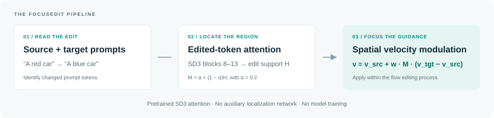

<div align="center">


### Training-Free Spatially-Modulated Guidance<br>for Background-Preserving Real Image Editing

**Guandong Li · Mengxia Ye**

[Quick start](#quick-start) · [Method](#method) · [Results](#results) · [Reproduce](docs/REPRODUCIBILITY.md) · [中文](README_zh.md)

<sub>Training-free &nbsp; / &nbsp; Stable Diffusion 3 Medium &nbsp; / &nbsp; PIE-Bench</sub>

</div>

<br>

**FocusEdit uses the image model’s own attention to locate an edit and concentrate guidance in that region.** It combines edited-token localization with spatial modulation of the target/source velocity difference, without training an additional model.

## At a glance

| Spatial focus | Background preservation | Reproducible evaluation |
|:---|:---|:---|
| Attention-derived edit regions; no auxiliary localization network | **57.4% lower background LPIPS** against the matched base editor | **700 edits**, seven configurations, **9,800** per-edit metric records |

The background reduction above uses the VAE reference; the RGB-reference reduction is **53.8%**. Full metrics and evaluation conditions are reported [below](#results).

## Quick start

Use **Python 3.11** and a CUDA-enabled PyTorch / torchvision installation. Obtain access to [SD3 Medium](https://huggingface.co/stabilityai/stable-diffusion-3-medium-diffusers) under its model license, then install:

```bash
git clone https://github.com/leeguandong/FocusEdit.git
cd FocusEdit
python -m pip install -e .
```

Edit an image from a source/target prompt pair:

```bash
focusedit --image input.png \
  --source-prompt "A photo of a red car" \
  --target-prompt "A photo of a blue car" \
  --output outputs/edited.png
```

The command saves the **edited image** and its **predicted edit mask**. Pass `--model weights/sd3-medium` to load your own model directory.

<details>
<summary><strong>Python API</strong></summary>

```python
from PIL import Image
from focusedit import FocusEditPipeline

editor = FocusEditPipeline.from_pretrained()
result = editor(Image.open("input.png"), "A red car", "A blue car")
result.image.save("edited.png")
```

</details>

<details>
<summary><strong>Default configuration</strong></summary>

| Setting | Value |
|:---|:---|
| Backbone | SD3 Medium |
| Resolution / precision | 512×512 / BF16 |
| Scheduler steps / editing steps / reference depth | 50 / 50 / 42 |
| Guidance scale | 13.5 |
| Attention blocks | 8–13 |
| Edit support / background floor | Binary / α = 0.2 |
| Encoding / localization / editing seeds | 123 / 124 / 123 |

Use `--config configs/focusedit_512.json` for an explicit configuration. Non-square images are center-cropped. Use `--baseline` for the unmodulated Navi-FlowAlign backbone under the same local protocol.

</details>

## Method



FocusEdit constructs the guidance map **M = α + (1 − α)H** from predicted support **H**. Full target/source guidance acts within the support; the background receives the configured guidance floor. The adaptive editing schedule and trajectory regularizer follow the base editor.

The implementation exposes the two FocusEdit components directly:

- [`attention.py`](focusedit/attention.py) — edited-token attention and edit-support construction.
- [`guidance.py`](focusedit/guidance.py) — spatial modulation of the velocity difference.

See the [method notes](docs/METHOD.md) for mask construction, continuous/oracle controls and the role of source residuals. Source residuals and spatial interactions can still move the background, including when direct guidance is zero.

## Results

**Fixed-protocol supplementary experiment on PIE-Bench.** All seven configurations use **512×512 / BF16**. Background metrics use the **556** samples with nonempty backgrounds; semantic metrics use all **700** edits. Background LPIPS is scaled by 1,000.

| Method | BG LPIPS · VAE ↓ | BG LPIPS · RGB ↓ | CLIP-edit ↑ |
|:---|---:|---:|---:|
| Base editor · Navi-FlowAlign | 125.353 | 128.903 | 23.086 |
| FocusEdit · binary, α = 0 | 46.070 | 52.746 | 22.773 |
| **FocusEdit · binary, α = 0.2** | **53.365** | **59.544** | **22.823** |
| FocusEdit · continuous, α = 0 | 28.141 | 35.621 | 22.418 |
| FocusEdit · continuous, α = 0.2 | 39.988 | 46.676 | 22.532 |
| Oracle · GT support, α = 0 | 7.555 | 16.134 | 23.327 |
| Oracle · GT support, α = 0.2 | 17.519 | 25.259 | 23.263 |

The default reduces background LPIPS by **57.4% (VAE)** and **53.8% (RGB)**. The paired CLIP-edit difference is **−0.264**, with a 95% bootstrap interval of **[−0.456, −0.078]**. All six metrics and valid counts are available in the [complete results](results/reported_means.json).

<details>
<summary><strong>Experiment scope and historical results</strong></summary>

These are fixed-protocol supplementary results. The original submission reported baseline / FocusEdit / oracle background LPIPS of 125.2 / 53.2 / 7.2 in a separate historical run. The original oracle and the matched-floor oracle above use different guidance-floor settings.

The released records correspond to the supplementary run. They are distinct from that historical run and from NaviEdit's published 34.49 score. The base editor's public default is 1024 / FP16; the paired experiment here uses 512 / BF16. See [protocol details](docs/REPRODUCIBILITY.md) for the reference images, random-number rules and evaluation conditions.

</details>

## Reproduce

**Check the reported means without a GPU:**

```bash
python results/recompute_means.py
```

The standard-library script verifies all **84 means and valid counts** from the **9,800** archived CSV rows. For generation, evaluation and paired bootstrap intervals, follow the [complete reproduction guide](docs/REPRODUCIBILITY.md).

| Resource | What it contains |
|:---|:---|
| [Experiment configuration](configs/focusedit_512.json) | Explicit inference and localization settings |
| [Reproduction guide](docs/REPRODUCIBILITY.md) | Data preparation, generation, evaluation and aggregation |
| [Per-edit records](results/controlled_per_edit_metrics.csv) | All seven methods and both reference images |
| [Release validation](docs/VALIDATION.md) | Output parity and statistical checks |

<details>
<summary><strong>Repository layout</strong></summary>

```text
focusedit/
  pipeline.py       Public FocusEdit inference interface
  attention.py      Edited-token localization
  guidance.py       Spatial guidance modulation
  config.py         FocusEdit defaults
  _backbone/        Attributed editing backbone and SD3 adapters
configs/            Experiment settings
reproduce/          Matched generation, evaluation and aggregation
results/            Per-edit metrics and independent replay
```

</details>

## Acknowledgments & citation

FocusEdit builds on **NaviEdit / Navi-FlowAlign** and **Stable Diffusion 3**. Evaluation follows **PIE-Bench / PnP**. Upstream versions, licenses and attribution are preserved in [Third-party notices](THIRD_PARTY_NOTICES.md). Manuscript metadata is provided in [CITATION.cff](CITATION.cff).

<p align="center"><sub>FocusEdit · Training-free image editing with spatial focus</sub></p>
