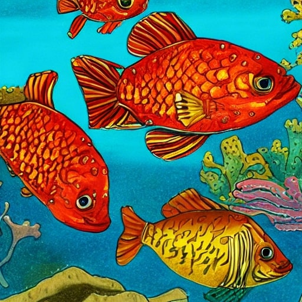
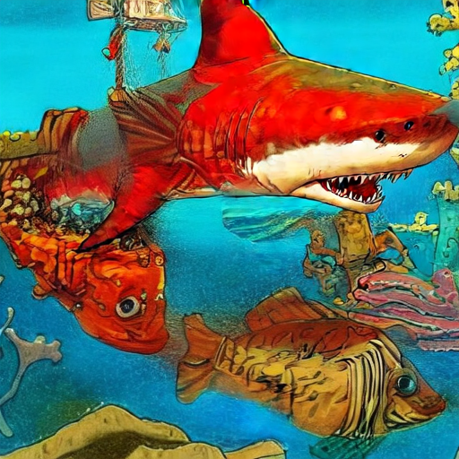
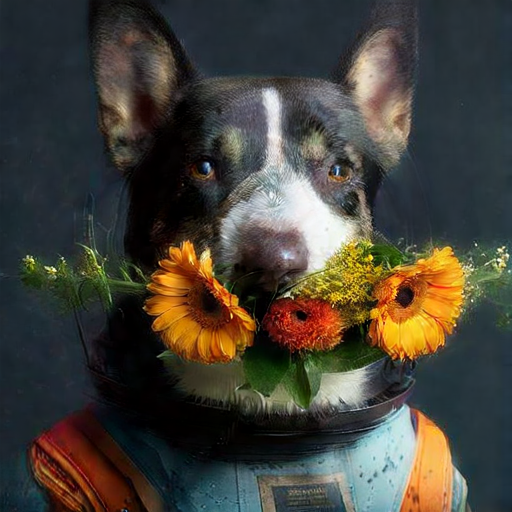
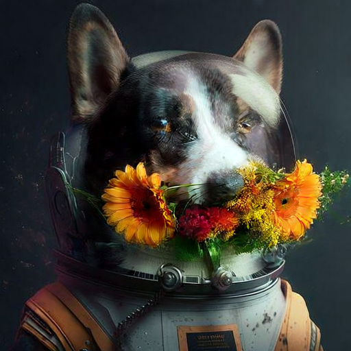
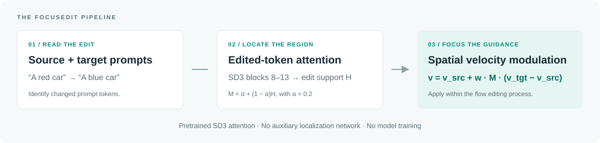

<div align="center">


### 无需训练的空间调制引导<br>用于保持背景的真实图像编辑

**Guandong Li · Mengxia Ye**

[快速开始](#快速开始) · [方法](#方法) · [实验结果](#实验结果) · [复现指南](docs/REPRODUCIBILITY.md) · [English](README.md)

<sub>无需训练 &nbsp; / &nbsp; Stable Diffusion 3 Medium &nbsp; / &nbsp; PIE-Bench</sub>

</div>

<br>

**FocusEdit 利用图像模型自身的注意力定位编辑区域，并将编辑引导集中在该区域。** 方法结合编辑词定位与目标／源条件速度差的空间调制，无需训练额外的定位模型。

<table>
  <tr>
    <th align="center" width="33%">源图</th>
    <th align="center" width="33%">基础编辑器</th>
    <th align="center" width="33%">FocusEdit</th>
  </tr>
  <tr>
    <td></td>
    <td></td>
    <td></td>
  </tr>
  <tr><td colspan="3" align="center"><sub>替换物体：鱼 → 鲨鱼</sub></td></tr>
  <tr>
    <td></td>
    <td></td>
    <td></td>
  </tr>
  <tr><td colspan="3" align="center"><sub>增加物体：穿宇航服的狗 → 嘴里叼着花</sub></td></tr>
</table>

<p align="center"><sub>PIE-Bench 示例 · 统一 512×512 / BF16 设置 · 默认 FocusEdit，α = 0.2</sub></p>

## 方法特点

| 空间定位 | 背景保持 | 可复算实验 |
|:---|:---|:---|
| 使用 SD3 编辑词注意力，无需额外定位网络 | 默认配置的背景 LPIPS 降低 **57.4%** | **700** 个样本、七组配置、**9,800** 条指标记录 |

以上降幅采用 VAE 重建参考图；采用原始 RGB 参考图时降幅为 **53.8%**。完整指标与评测条件见[实验结果](#实验结果)。

## 快速开始

使用 **Python 3.11**，安装适合 GPU 的 PyTorch / torchvision，并从提供方获得 [SD3 Medium](https://huggingface.co/stabilityai/stable-diffusion-3-medium-diffusers) 权重及相应许可。

```bash
git clone https://github.com/leeguandong/FocusEdit.git
cd FocusEdit
python -m pip install -e .
```

```bash
focusedit --image input.png \
  --source-prompt "A photo of a red car" \
  --target-prompt "A photo of a blue car" \
  --output outputs/edited.png
```

命令会保存**编辑结果**与**预测编辑掩码**。使用 `--model weights/sd3-medium` 可指定自备权重目录。

<details>
<summary><strong>Python 接口</strong></summary>

```python
from PIL import Image
from focusedit import FocusEditPipeline

editor = FocusEditPipeline.from_pretrained()
result = editor(Image.open("input.png"), "A red car", "A blue car")
result.image.save("edited.png")
```

</details>

<details>
<summary><strong>默认配置</strong></summary>

| 设置 | 数值 |
|:---|:---|
| 基础模型 | SD3 Medium |
| 分辨率／精度 | 512×512 / BF16 |
| 调度步数／编辑步数／参考深度 | 50 / 50 / 42 |
| CFG 引导尺度 | 13.5 |
| 注意力层 | 8–13 |
| 区域图／背景引导下限 | 二值／α = 0.2 |
| 编码／定位／编辑种子 | 123 / 124 / 123 |

完整参数见 [focusedit_512.json](configs/focusedit_512.json)。非正方形输入会进行中心裁剪。`--baseline` 在相同本地协议下运行未调制的 Navi-FlowAlign 基础编辑器。

</details>

## 方法



FocusEdit 根据预测区域 **H** 构造引导图 **M = α + (1 − α)H**：区域内保留完整目标／源速度差引导，背景使用设定的引导下限。底层自适应调度和轨迹正则化沿用基础编辑过程。

- [attention.py](focusedit/attention.py)：编辑词注意力提取与区域图构造。
- [guidance.py](focusedit/guidance.py)：对目标／源条件速度差进行空间调制。

完整机制见[方法说明](docs/METHOD.md)。源状态残差与跨区域相互作用仍可带来背景更新，包括直接引导权值为零时。

## 实验结果

**PIE-Bench 固定协议补充实验。** 七组配置均采用 **512×512 / BF16**；背景指标使用 **556** 个非空背景样本，语义指标使用全部 **700** 个编辑样本。背景 LPIPS 乘以 1,000 展示。

| 方法 | 背景 LPIPS · VAE ↓ | 背景 LPIPS · RGB ↓ | CLIP-edit ↑ |
|:---|---:|---:|---:|
| 基础编辑器 · Navi-FlowAlign | 125.353 | 128.903 | 23.086 |
| FocusEdit · 二值，α = 0 | 46.070 | 52.746 | 22.773 |
| **FocusEdit · 二值，α = 0.2** | **53.365** | **59.544** | **22.823** |
| FocusEdit · 连续，α = 0 | 28.141 | 35.621 | 22.418 |
| FocusEdit · 连续，α = 0.2 | 39.988 | 46.676 | 22.532 |
| Oracle · 真实区域，α = 0 | 7.555 | 16.134 | 23.327 |
| Oracle · 真实区域，α = 0.2 | 17.519 | 25.259 | 23.263 |

默认配置相对基础编辑器的背景 LPIPS 降低 **57.4%（VAE）**和 **53.8%（RGB）**。CLIP-edit 配对均值差为 **−0.264**，95% bootstrap 区间为 **[−0.456, −0.078]**。全部六项指标及有效计数见[完整结果](results/reported_means.json)。

<details>
<summary><strong>实验范围与历史结果</strong></summary>

上表为固定协议补充实验。原投稿另一次历史运行中，基础编辑器／FocusEdit／Oracle 的背景 LPIPS 为 125.2 / 53.2 / 7.2；原 Oracle 与本次统一下限 Oracle 的引导下限设置不同。

仓库中的逐例记录对应补充实验，与原投稿历史运行及 NaviEdit 原论文报告的 34.49 分别标注。基础编辑器公开默认设置为 1024 / FP16，本地配对实验明确使用 512 / BF16。参考图、随机数流程和评测设置见[复现文档](docs/REPRODUCIBILITY.md)。

</details>

## 复现实验

**无需 GPU 即可核对全部汇总均值：**

```bash
python results/recompute_means.py
```

脚本仅依赖 Python 标准库，从 **9,800** 条逐例记录复算 **84** 项均值及有效计数。完整生成、评测和配对区间计算见[复现指南](docs/REPRODUCIBILITY.md)。

| 资料 | 内容 |
|:---|:---|
| [实验配置](configs/focusedit_512.json) | 推理与定位参数 |
| [复现指南](docs/REPRODUCIBILITY.md) | 数据准备、生成、评测与汇总 |
| [逐例指标](results/controlled_per_edit_metrics.csv) | 七配置、双参考完整记录 |
| [发布验证](docs/VALIDATION.md) | 输出一致性与统计核查 |

## 致谢与引用

FocusEdit 基于 **NaviEdit / Navi-FlowAlign** 和 **Stable Diffusion 3**，评测采用 **PIE-Bench / PnP**。上游版本、许可和署名见[第三方说明](THIRD_PARTY_NOTICES.md)，论文元数据见 [CITATION.cff](CITATION.cff)。

<p align="center"><sub>FocusEdit · 聚焦编辑区域，提升背景保持</sub></p>
